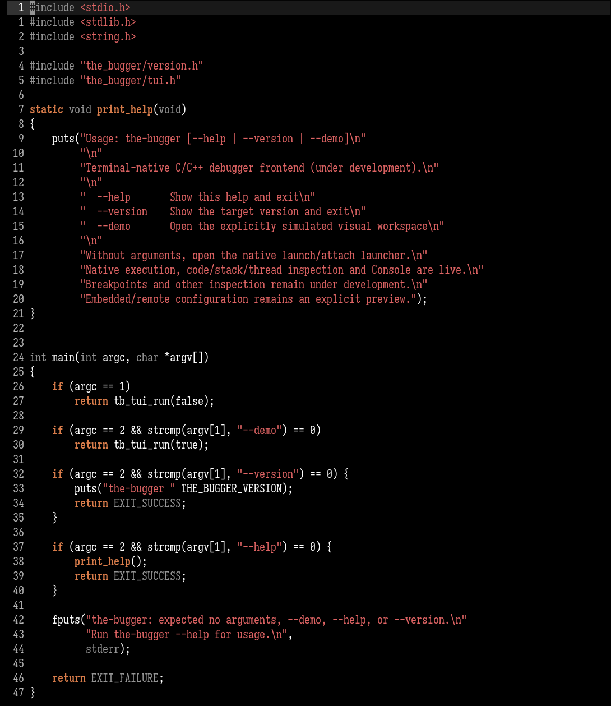
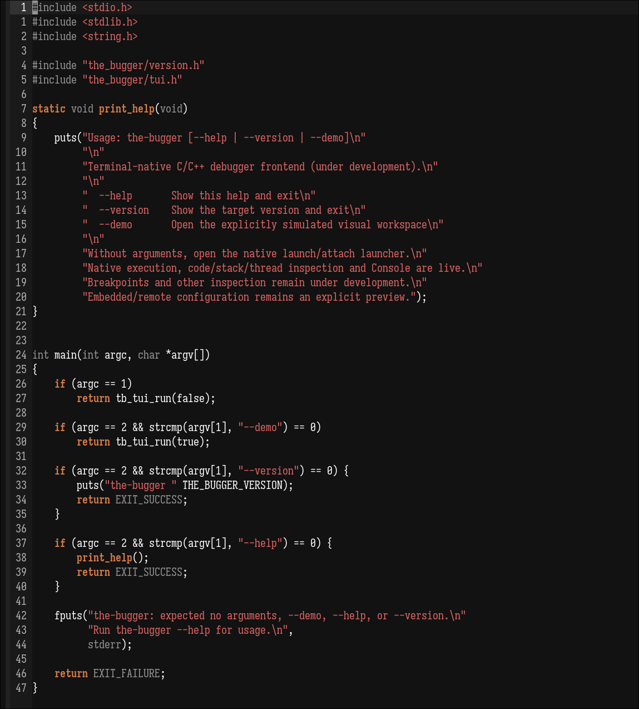

# Ashen Minimal




[Ashen](https://github.com/ficd0/ashen/tree/main/emacs) for Emacs with restrained
syntax highlighting, for Emacs 27.1 or newer. `ashen-minimal-hc` uses pure black
(`#000000`) foundational backgrounds; `ashen-minimal` uses Ashen's original
dark-gray backgrounds. Their syntax colors and styling are identical.

Selections, search results, completion menus, and mode lines retain contrasting
backgrounds. Ordinary code is white, keywords are bold orange, strings are red,
and comments are upright gray. Function definitions and calls use normal weight.

## Installation

Clone the repository:

```sh
git clone https://github.com/gnix0/ashen-hc-theme ~/.emacs.d/themes/ashen-hc-theme
```

Add this to your Emacs configuration:

```elisp
(add-to-list 'custom-theme-load-path
             (expand-file-name "~/.emacs.d/themes/ashen-hc-theme/"))
(load-theme 'ashen-minimal-hc t)
```

Use `(load-theme 'ashen-minimal t)` for Ashen's original backgrounds.

Keep `ashen-minimal-hc-theme.el`, `ashen-minimal-theme.el`, and
`ashen-minimal-theme-common.el` together in a directory on
`custom-theme-load-path`. Select `ashen-minimal-hc` or `ashen-minimal`
with `M-x load-theme`.
For exact colors, use graphical Emacs or a terminal configured for true color.
Disable other enabled themes before loading if you want to avoid their faces
showing through in modes they cover.

## Face mapping

The themes adapt the
[official Emacs port](https://github.com/ficd0/ashen/blob/main/emacs/ashen-theme.el)
with a smaller set of syntax roles. In `ashen-minimal-hc`, the foundational
background, fringes, ordinary line numbers, menus, and source blocks use black.
`ashen-minimal` restores Ashen's original backgrounds for those surfaces.

| Role | Emacs faces | Appearance |
| --- | --- | --- |
| Editing area | `default` | `#ffffff` on the chosen background |
| Comments and documentation | comment and documentation faces | `#737373`, upright |
| Strings and escapes | string and escape faces | `#DF6464` |
| Function definitions / calls | function name / call faces | `#ffffff`, normal weight |
| Builtins, constants, numbers | corresponding font-lock faces | `#ffffff` |
| Types and preprocessor directives | corresponding font-lock faces | `#949494` |
| Keywords | `font-lock-keyword-face` | `#D87C4A`, bold |
| Operators, properties, punctuation | corresponding font-lock faces | `#ffffff` |
| Selection | `region` | `#323232` background, preserves syntax foregrounds |
| Line / general highlighting | `hl-line`, `highlight` | `#191919` background |
| Matching parentheses | `show-paren-match` | `#151515` on `#737373` |
| Search | `isearch`, `lazy-highlight` | original inverse-video orange highlights |
| Mode line | active / inactive mode lines | white / gray on `#212121` |
| Tooltip | `tooltip` | gray on `#212121`, gray border |
| Dired | directories / symlinks | `#D87C4A` / `#B14242` |
| Org | headings / inline code | orange headings, `#C4693D` code |
| Eglot | inlay hints | `#737373`, small and italic |

Built-in Tree-sitter major modes use the font-lock faces. Optional
`emacs-tree-sitter` syntax faces use the same restrained roles. Both themes
apply the same C highlighting profile in `c-ts-mode`, keeping user-defined type
aliases neutral and coloring quoted literals inside macros. Previous
fontification settings are restored when switching away. This profile requires
Emacs 29 or newer and a C grammar.

Additional tab-bar, Company, Corfu, diff, Magit, diagnostic, and ANSI faces
retain their mappings from
[ashen.nvim](https://github.com/ficd0/ashen.nvim/blob/main/lua/ashen/variants/default/theme.lua)
where the official Emacs port has no equivalent. In particular, additions
stay gray, deletions ember red, and the ANSI "green" stays orange.
