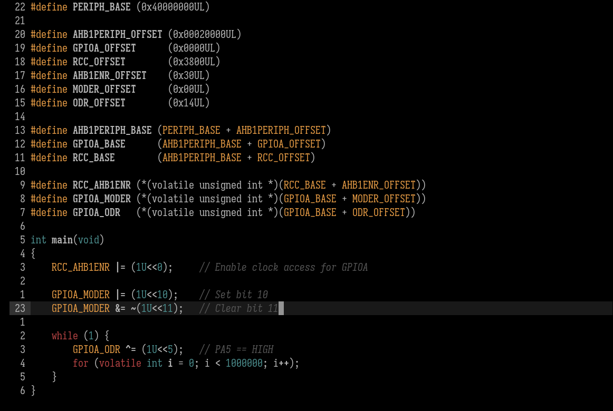

# Ashen High-Contrast



*Screenshot shows the earlier Neovim-based styling.*

[Ashen](https://github.com/ficd0/ashen/tree/main/emacs) for Emacs, built around a pure
black (`#000000`) foundational background. A standalone theme with no
dependencies, for Emacs 27.1 or newer.

The official Emacs port's syntax roles, styling, and highlight surfaces are preserved.
Editing buffers, inactive windows, fringes, and source blocks sit on black;
selections, search results, completion menus, and mode lines retain their
original contrasting backgrounds. Comments are italic, function definitions
are bold, and types and builtins use muted teal, following the official Emacs
port. Function calls retain normal weight.

## Installation

Clone the repository:

```sh
git clone https://github.com/gnix0/ashen-hc-theme ~/.emacs.d/themes/ashen-hc-theme
```

Add this to your Emacs configuration:

```elisp
(add-to-list 'custom-theme-load-path
             (expand-file-name "~/.emacs.d/themes/ashen-hc-theme/"))
(load-theme 'ashen-hc t)
```

You can also copy `ashen-hc-theme.el` to any directory on
`custom-theme-load-path` and select `ashen-hc` with `M-x load-theme`.
For exact colors, use graphical Emacs or a terminal configured for true color.
Disable other enabled themes before loading if you want to avoid their faces
showing through in modes they cover.

## Face mapping

Faces shared with the
[official Emacs port](https://github.com/ficd0/ashen/blob/main/emacs/ashen-theme.el)
follow its Emacs-specific decisions. The foundational `background` changes
from `#121212` to `#000000`; fringes, ordinary line numbers, menus, and source
blocks also use black. The named grayscale and accent colors retain their
upstream values.

| Role | Emacs faces | Appearance |
| --- | --- | --- |
| Editing area | `default` | `#b4b4b4` on black |
| Comments | `font-lock-comment-face` | `#535353`, italic |
| Strings and docstrings | string and documentation faces | `#DF6464` |
| Function definitions / calls | function name / call faces | `#b4b4b4`, bold definitions, normal calls |
| Builtins, constants, types, numbers | corresponding font-lock faces | `#4A8B8B` |
| Keywords | `font-lock-keyword-face` | `#B14242` |
| Operators and properties | corresponding font-lock faces | `#C4693D` |
| Preprocessor and escapes | corresponding font-lock faces | `#E49A44` |
| Selection | `region` | `#323232` background, preserves syntax foregrounds |
| Line / general highlighting | `hl-line`, `highlight` | `#191919` background |
| Matching parentheses | `show-paren-match` | `#151515` on `#737373` |
| Search | `isearch`, `lazy-highlight` | original inverse-video orange highlights |
| Mode line | active / inactive mode lines | `#b4b4b4` on `#212121` |
| Tooltip | `tooltip` | gray on `#212121`, gray border |
| Dired | directories / symlinks | `#D87C4A` / `#B14242` |
| Org | headings / inline code | orange headings, `#C4693D` code |
| Eglot | inlay hints | `#737373`, small and italic |

Built-in Tree-sitter major modes use the font-lock faces. Optional
`emacs-tree-sitter` faces follow the official port's separate capture mappings;
the theme does not load or require either Tree-sitter package. Major modes
retain their own syntax rules and decide which faces apply.

Additional tab-bar, Company, Corfu, diff, Magit, diagnostic, and ANSI faces
retain their mappings from
[ashen.nvim](https://github.com/ficd0/ashen.nvim/blob/main/lua/ashen/variants/default/theme.lua)
where the official Emacs port has no equivalent. In particular, additions
stay gray, deletions ember red, and the ANSI "green" stays orange.

Two small corrections preserve usability: function calls explicitly use normal
weight so they do not inherit bold definitions, and selected completions and
terminal menus use black text on the upstream light-gray selection surface.
Org levels 4–8 continue the official orange heading pattern.

## Validation

Run `make check` to byte-compile the theme with warnings treated as errors.
